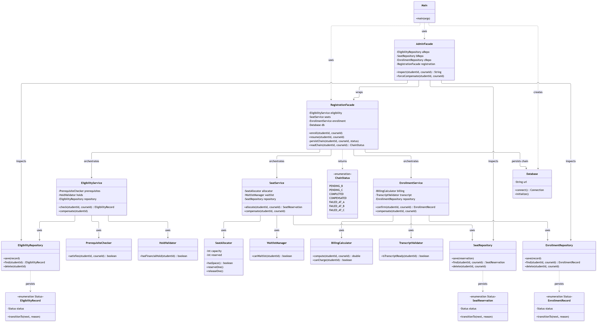

# Assignment 4: University Registration

A Java implementation of the **Facade pattern** over three independent subsystems: 
A (Eligibility), B (Seat Allocation), and C (Enrollment).

The `RegistrationFacade` coordinates the A -> B -> C chain. State is persisted to a SQLite database. If a later step fails, the facade compensates the already-committed earlier steps.

## Least Knowledge

**Before:** Without a facade, the client has to talk to all three subsystems directly and manage the rollback sequence itself. It has three immediate friends.

```java
// Client must construct all 3 services...
EligibilityService a = new EligibilityService(...);
SeatService b = new SeatService(...);
EnrollmentService c = new EnrollmentService(...);

// ...and manually handle the chain + rollbacks
try {
    a.check("S1", "SE101");
    try {
        b.allocate("S1", "SE101");
        try {
            c.confirm("S1", "SE101");
        } catch (SubsystemCFailure e) {
            b.compensate("S1", "SE101");
            a.compensate("S1");
            throw e;
        }
    } catch (SubsystemBFailure e) {
        a.compensate("S1");
        throw e;
    }
} catch (SubsystemAFailure e) { }
```

**After:** With the facade, the client has exactly one immediate friend and no knowledge of compensation order.

```java
RegistrationFacade registration = new RegistrationFacade(a, b, c, db);
registration.enroll("S1", "SE101");
```

## Facade vs. Adapter

An Adapter translates the interface of one class into another interface that a client expects. Its goal is to make an existing class usable without changing its source.

This project requires a Facade, not an Adapter, because the core problem isn't translating an interface—it's orchestrating a sequence. The subsystems (EligibilityService, SeatService, EnrollmentService) already have clean, usable interfaces. But calling them requires the client to know the exact ordering (A -> B -> C) and the precise rollback logic if a later step fails.

If we used Adapters to wrap the three subsystems, the client would still be responsible for calling them in the right order and executing the two-depth rollback. An Adapter per subsystem would just rename the methods, leaving the coordination homeless. The Facade provides a new, unified interface that owns the chain logic and hides it from the client. The intent here is simplification through coordination, which is the definition of a Facade.

## UML Class Diagram



## How to run

Requires JDK 17 and Maven.

```bash
# 1. Build the project, run tests, and generate the coverage report
mvn clean package

# 2. Run the CLI application
java -jar target/registration-1.0.0.jar

# To reset the database to a clean state before a fresh run, delete the SQLite file (or run the included script):
./reset-db.sh
```